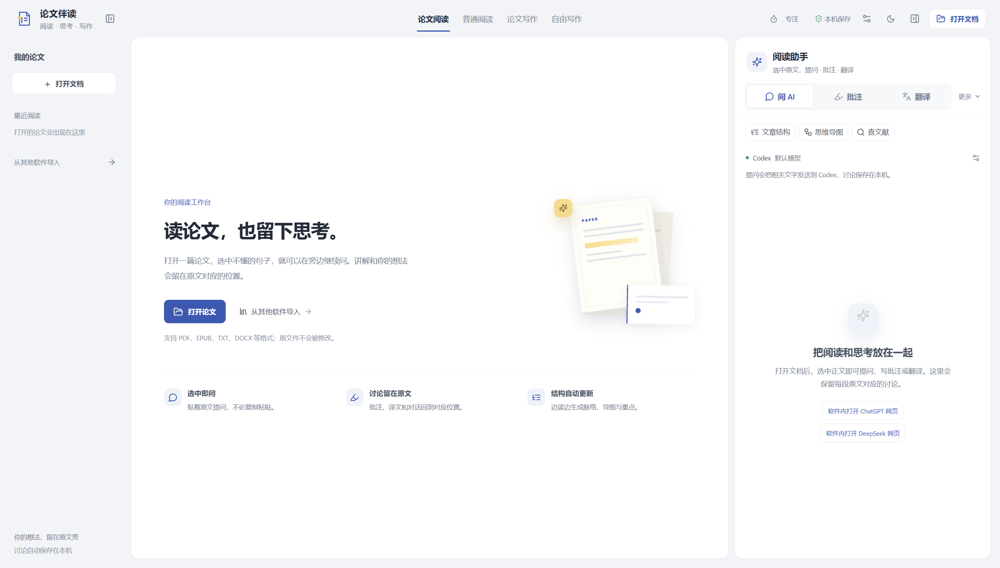

# 论文伴读（免费测试版）

阅读论文时，在原文旁提问、记录想法，并在之后回到相应位置继续阅读。

本软件免费，当前面向 Windows。测试版仍在完善，欢迎反馈安装、阅读和使用中的问题。

**[下载 Windows 免费测试版](https://github.com/youchibuwan-ops/paper-companion-releases/releases/tag/v0.6.1-asar-beta.1)** · **[反馈问题](https://github.com/youchibuwan-ops/paper-companion-releases/issues/new/choose)**

此仓库用于发布安装包、使用说明和收集反馈，目前不公开源码仓库。程序采用 ASAR 封装；ASAR 是归档格式，不是代码加密。

当前版本：0.6.1 ASAR 免费测试版。程序内版本号为 0.6.1。

## 下载与安装

在上面的下载页面选择附件 `PaperCompanion-Setup.exe`，双击安装。无需下载 GitHub 自动生成的 Source code 压缩包，它们只包含本仓库的发布资料。安装时可以选择程序目录。安装包目前没有数字签名，Windows 可能显示相关提示。

## 开始使用

1. 打开软件，选择「论文阅读」，打开本机 PDF。
2. 在右侧选择可用的 AI 服务，并按界面提示配置账号或 API 密钥。
3. 选中论文中需要理解的文字，输入问题；也可以添加自己的批注。
4. 之后重新打开同一文件，点击标注位置可找回相关内容。

软件本身免费。AI 服务需用户自行配置，API 调用可能由服务商另行收费，不能将网页免费额度视为 API 额度。所选论文文字和问题会发送给所选的 AI 服务；图片提问还会发送选中的图片。请根据论文内容选择是否使用。

## 其他功能与限制

- 支持本机英译中；首次使用需下载翻译模型，专业术语和含义需要对照原文检查。
- 支持论文写作和导出 Word。普通阅读还支持多种文本格式，部分格式需要额外工具。
- 扫描版 PDF 没有可提取文字时无法直接选中文字。AI 的解释和翻译可能出错，请核对原文。
- 文件位置、批注和本机 AI 讨论保存在本机；网页对话的回答保存在相应官网账号中。原始文件不会被写入或覆盖。
- 程序通过路径、大小和修改时间识别文件版本；如果文件内容发生变化但大小和修改时间都未变，可能无法识别。

## 反馈

欢迎在本仓库的 Issues 中反馈。请注明 Windows 版本、软件版本、复现步骤和错误提示；请勿提交 API 密钥、私人论文或其他敏感内容。
