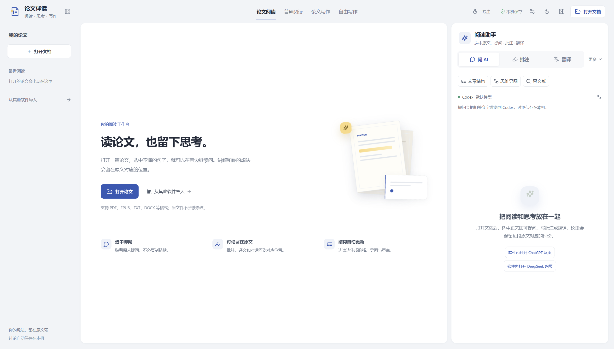

# 论文伴读 Paper Companion（免费测试版）

阅读论文和书籍，把提问、批注与讨论留在对应原文旁；也可以写稿并导出 Word。

软件免费，当前面向 Windows。AI 账户、API 额度与相关费用按各服务商规则单独管理。

**[下载 Windows 免费测试版](https://github.com/youchibuwan-ops/paper-companion-releases/releases)** · **[反馈问题](https://github.com/youchibuwan-ops/paper-companion-releases/issues/new/choose)**

当前版本：**0.6.30**，发布标签：**v0.6.30-beta.1**。

此仓库发布安装包、使用说明、第三方许可和反馈资料；开发工程未在此仓库公开。

## 这次更新

- 恢复联合构筑原有的分析要求：观点、方法、公式与符号定义、假设、证据、结论；明确区分作者原文、用户想法与推测，比较公式的实质差异和适用条件，证据不足时说明未知。
- 保留原PDF/完整页图输入、原整理服务、模型与档位、输出结构和布局；已有结果与讨论保留，不自动重跑。

此前版本已提供：

- 读取已有 DSH 模型通道，按通道显示模型，保留原接口与密钥配置。
- 修复 PDF 选字与换行噪声；原生会话保存、恢复及跨选区追问。
- 全文阅读改用原 PDF 或完整原版页图，不以提取文字或分块摘要代替。
- 联合构筑保留原布局与整理服务，可继续讨论，并可删除构筑及其本地讨论。
- 右上角区分项目工具与 API 平台，显示所选模型的 PDF 阅读方式；详见 [完整更新说明](RELEASE-NOTES.md)。

## 0.6.16 的百炼适配

- 修复百炼渠道只显示 Qwen 的限制，模型列表同时读取 Qwen 和 DeepSeek，支持带供应商前缀的模型 ID。
- 原「千问 Qwen」入口改为「阿里云百炼」，原有百炼密钥和模型设置继续使用。百炼 DeepSeek 在这个入口选择；「DeepSeek API」独立连接 DeepSeek 官网。
- 已安装 0.6.15 / 0.6.16 的使用者，可在「设置 → 软件更新」检查并下载本页当前版本，再点击「退出并安装更新」。0.6.14 及以前先手动下载本版安装包一次。

## 软件内更新

- 新增「设置 → 软件更新」：启动后检查新版本，也可手动检查或关闭启动检查。
- 发现更新时显示版本说明；主动下载，显示进度，可取消与重试。
- 安装前先保存稿件、阅读位置、缩放和设置，经确认关闭窗口并安全退出自己的空闲后台服务，自动覆盖当前目录并重新打开。
- 保存失败、已有批注正在编辑或选区状态未保存时保留窗口并提示处理；批注、讨论和稿件继续使用原有数据目录。
- 旧版后台仍占用组件时，安装器在写入前停止并提示重启 Windows，保护原程序。

## 安装和开始

下载附件 **PaperCompanion-Setup.exe**，双击安装。GitHub 自动生成的 Source code 压缩包只包含本仓库的发布资料。程序默认安装到 D 盘，可选择其他空目录或已登记的程序目录。安装前请关闭论文伴读窗口。安装包尚未数字签名，Windows 可能显示相应提示。

1. 打开软件，选择「论文阅读」，打开本机 PDF。
2. 选择 AI 服务。Codex、Claude Code 与 DSH 需要先在本机安装并配置可用账户；DeepSeek、Claude、Qwen API 使用各自的密钥和模型。
3. 选中原文后提问、写批注、翻译或查资料。问答可从对应原文或「讨论记录」找回。
4. Codex、Claude Code 或 DSH 可指定本机项目目录，也可留空使用本篇论文的独立持续会话。可主动开始整篇图文初读，并在同一会话继续追问。
5. 选错范围可点击「取消选区」或按 Esc；同一文件重开时恢复阅读位置与缩放。

## 软件更新

0.6.14 及以前需要先手动下载安装本版一次。此后可在「设置 → 软件更新」查看版本说明、下载并安装；启动检查只给出提示，下载和安装由你主动选择。测试版会检查更新的测试版。

首次覆盖旧版时请先关闭软件；若安装器提示后台占用，请重启 Windows 后再安装。应用数据独立保存，不会因覆盖程序而清空。检查只查询项目的 GitHub 公开版本信息，不上传论文、稿件或密钥。当前分发尚未数字签名。

对外分享可以一直使用本仓库的 [下载页](https://github.com/youchibuwan-ops/paper-companion-releases/releases)，后续发布新版无需修改分享链接。下载附件 **PaperCompanion-Setup.exe**。

## 会话与数据

Codex、Claude Code 与 DSH 分别保留原生会话；首次提供原 PDF 或全部原版页图后，继续追问沿用已保存会话。切换选区不新建会话，旧对话可选回。DSH 模型按原有通道分组，使用已有配置与凭据。

API 直连会保存本地讨论，但不等于服务商保存了全文背景。后续请求需携带原 PDF/页图与历史，仍可能计费。Claude API、已接入的百炼 PDF 模型走 PDF 文档输入；DeepSeek Flash 与已接入的百炼视觉模型走完整页图。平台、模型和地域限制会明确提示，不会自动换模型或退回文字摘要。图文输入不保证 AI 理解正确，须结合原文核对。

正文、问题、图片或明确开启的全文图文会发送至所选服务；密钥与个人阅读数据不包含在安装包中。第三方原生程序的日志与数据处理受其自身配置约束。具体支持范围与验证边界见 [版本说明](RELEASE-NOTES.md)。

原文件留在原位置，只读打开；批注、想法、讨论和译文独立保存在本机，设置中可查看数据目录。相同文字在不同位置仍分别关联。文件版本按路径、大小和修改时间识别；内容变化但大小及修改时间均未变时，可能无法识别。

## 阅读、翻译与写作

- 本机英译中首次下载约 114 MiB 模型；安装后翻译不向网络发送原文。支持选区、本页与全文翻译，译文可编辑保存。
- 支持论文写作、自由写作、公式编辑及 Word 导出。AI 讨论不会自动覆盖用户正文。
- 普通阅读支持多种文本格式，部分格式依赖额外工具。扫描页可看原图，没有文字层时无法直接选字。
- AI 解释、翻译及检索摘要需结合原文核对；摘要与书目不代表全文授权。原文件读取失败或超过所选服务的页数、容量或上下文限制时明确报错，不自动截断。

## 许可与素材来源

设置 →「关于与许可」提供随包离线材料，翻译栏也可查看模型来源。仓库保留 [第三方通知](THIRD-PARTY-NOTICES.txt)、[运行依赖清单](THIRD-PARTY-PACKAGES.json)及[版本与来源](sources.json)。

界面预览使用 Maureen A. Carey、Kevin L. Steiner、William A. Petri Jr 的论文 *Ten simple rules for reading a scientific paper*（2020），[DOI: 10.1371/journal.pcbi.1008032](https://doi.org/10.1371/journal.pcbi.1008032)，[CC BY 4.0](https://creativecommons.org/licenses/by/4.0/)。预览含软件高亮、中文讨论与界面裁切。

论文伴读是独立工具。所列 AI 服务名称用于说明实际接入方式，不表示官方合作或背书。

## 反馈

请在 Issues 中注明 Windows 版本、软件版本、复现步骤和错误提示；请勿提交 API 密钥、私人论文、聊天记录或其他敏感内容。

